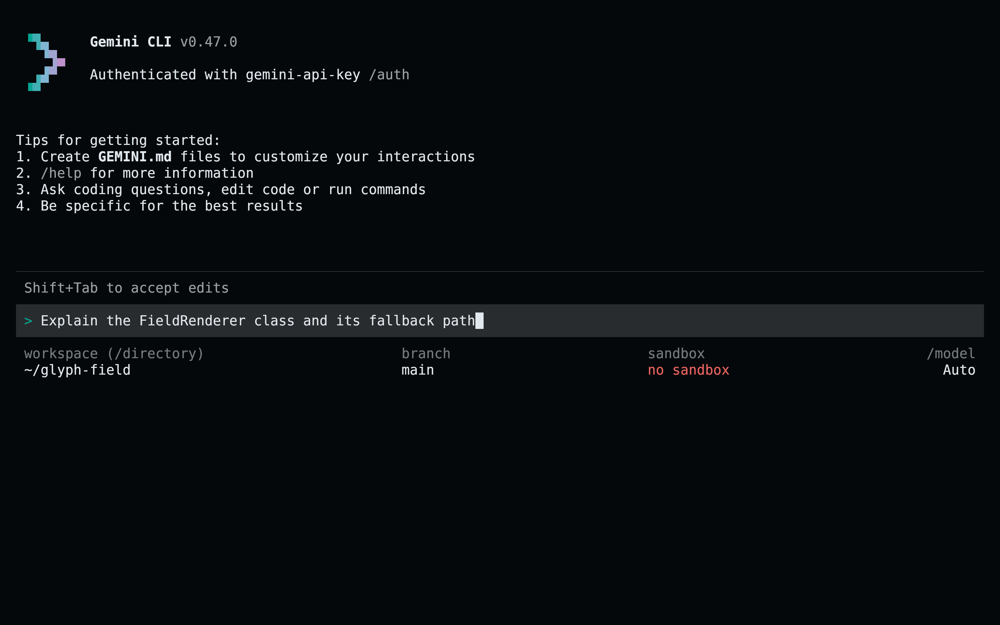
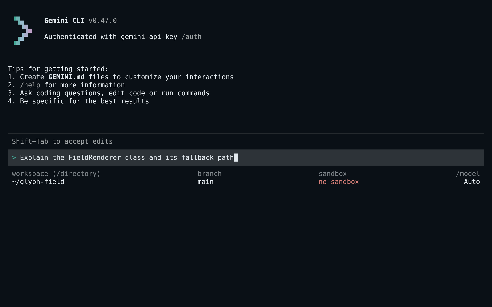
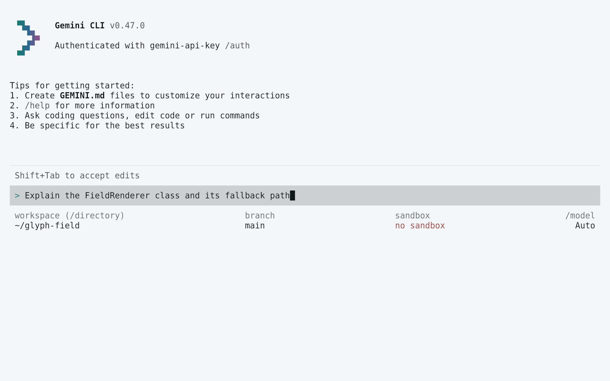
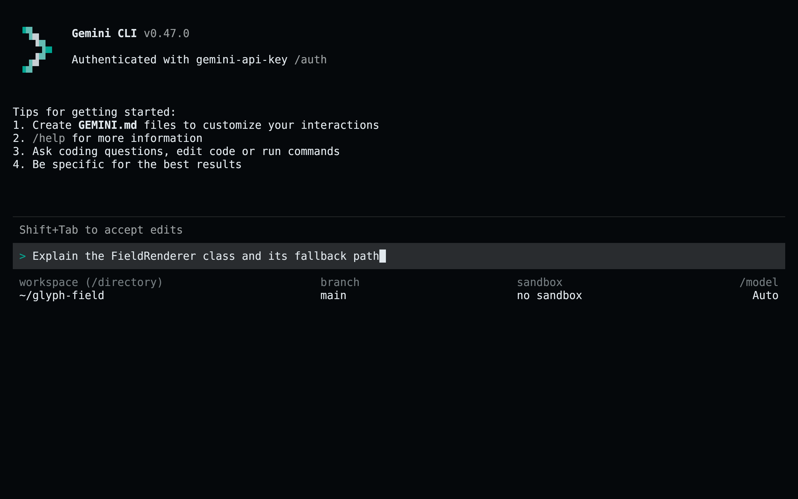

<!-- living-code-readme:1 -->
# ♊ Living Code for Gemini CLI

**Calm slate. Living color.** Living Code for Gemini CLI: standalone custom theme files for conversational text, borders, status indicators and diff backgrounds.

[Installation](#installation) · [Flavors](#flavors) · [Configuration](#configuration) · [All ports](https://github.com/living-code-theme)

## Previews

<table data-lc-flavors>
<tr>
<td width="50%" valign="top">
<strong>Night</strong><br><sub>Dark · full palette</sub><br><br>
<a href="images/night.png"></a>
</td>
<td width="50%" valign="top">
<strong>Frost</strong><br><sub>Dark · softer chroma</sub><br><br>
<a href="images/frost.png"></a>
</td>
</tr>
<tr>
<td width="50%" valign="top">
<strong>Paper</strong><br><sub>Light · near-white slate</sub><br><br>
<a href="images/paper.png"></a>
</td>
<td width="50%" valign="top">
<strong>Signal</strong><br><sub>Dark · teal accent</sub><br><br>
<a href="images/signal.png"></a>
</td>
</tr>
</table>

Select any preview to view the image at full size.

## Installation

```sh
flavor=night # night, frost, paper, or signal
curl -fsSL --create-dirs -o "$HOME/.gemini/themes/living-code-$flavor.json" "https://raw.githubusercontent.com/living-code-theme/gemini-cli/main/themes/living-code-$flavor.json"
printf "%s\n" "$HOME/.gemini/themes/living-code-$flavor.json"
```

Copy the printed absolute path into `ui.theme` in your existing `~/.gemini/settings.json`, preserving other settings. For example:

```json
{
  "ui": {
    "theme": "/home/you/.gemini/themes/living-code-night.json"
  }
}
```

Replace `/home/you` with your home directory and restart Gemini CLI. The theme file must stay inside your home directory.

## Flavors

Expand a flavor for its full-size preview and activation instructions.

<details data-lc-flavor="night">
<summary><strong>Night</strong> · Dark · full palette</summary>

<p><a href="images/night.png"></a></p>

Set `ui.theme` to the absolute path of `~/.gemini/themes/living-code-night.json` in your settings, then restart Gemini CLI.

</details>

<details data-lc-flavor="frost">
<summary><strong>Frost</strong> · Dark · softer chroma</summary>

<p><a href="images/frost.png"></a></p>

Set `ui.theme` to the absolute path of `~/.gemini/themes/living-code-frost.json` in your settings, then restart Gemini CLI.

</details>

<details data-lc-flavor="paper">
<summary><strong>Paper</strong> · Light · near-white slate</summary>

<p><a href="images/paper.png"></a></p>

Set `ui.theme` to the absolute path of `~/.gemini/themes/living-code-paper.json` in your settings, then restart Gemini CLI.

</details>

<details data-lc-flavor="signal">
<summary><strong>Signal</strong> · Dark · teal accent</summary>

<p><a href="images/signal.png"></a></p>

Set `ui.theme` to the absolute path of `~/.gemini/themes/living-code-signal.json` in your settings, then restart Gemini CLI.

</details>

## Configuration

The distributable files are standalone `type: "custom"` theme documents, not full settings files. As an alternative, insert a document into `ui.customThemes` using its `name` as the object key, then select it by name. A path selected through `ui.theme` must be removed before changing themes with `/theme`.

## Compatibility

Uses the documented standalone-file custom theme API. Gemini CLI permits theme paths only within the home directory: do not point it at a clone under `/tmp` or a system-wide location. Text, background, diff, border, status and UI groups are provided; code highlighting follows Gemini CLI’s derived theme behavior. Tests validate the nested format, not provider access or model output.

Previews are captured programmatically from the actual application in an isolated profile. See [`capture/app.py`](capture/app.py) for the app-owned recipe and [`images/capture.json`](images/capture.json) for runtime, palette and image provenance. No mock interface is drawn.

## Contributing

Found a problem? [Open an issue](https://github.com/living-code-theme/gemini-cli/issues/new/choose) with the app version, the flavor and a screenshot. Want Living Code somewhere else? [Request a port](https://github.com/living-code-theme/core/issues/new?template=port-request.yml).

Pull requests are welcome. Keep this README, `port.json` and `images/` in sync, and use real screenshots of the app, never mockups.

🦎 **One chameleon, many habitats.** Part of [Living Code](https://github.com/living-code-theme).

## License

[MIT](LICENSE) © Elliot Luque
